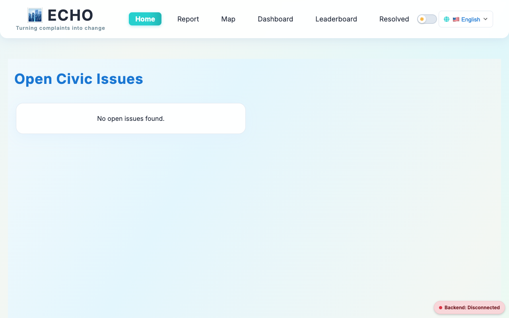
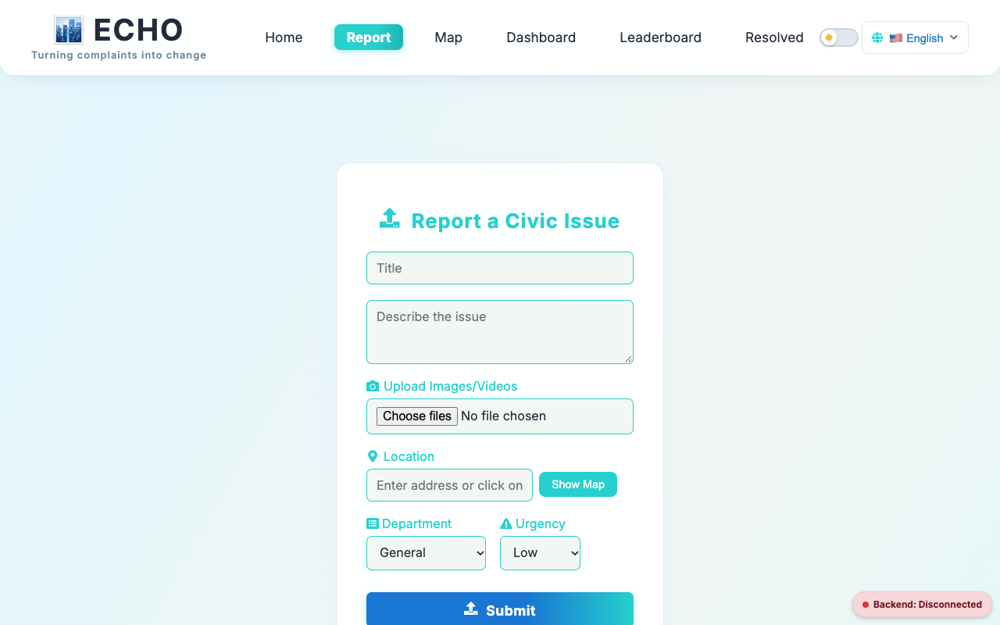
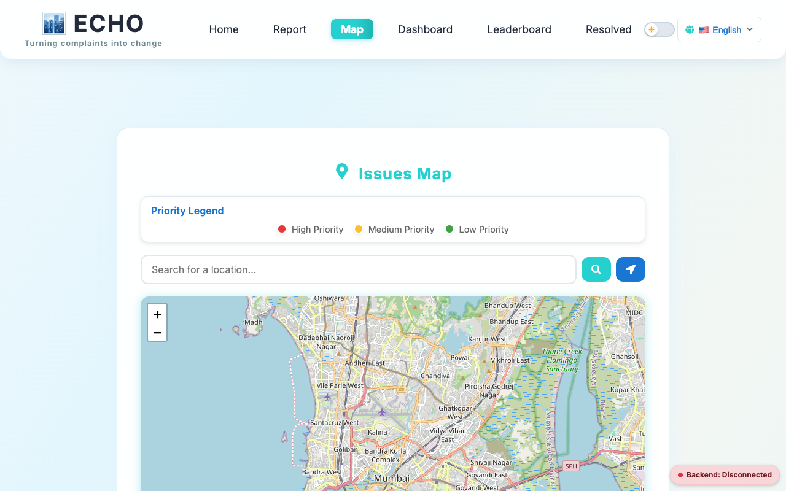
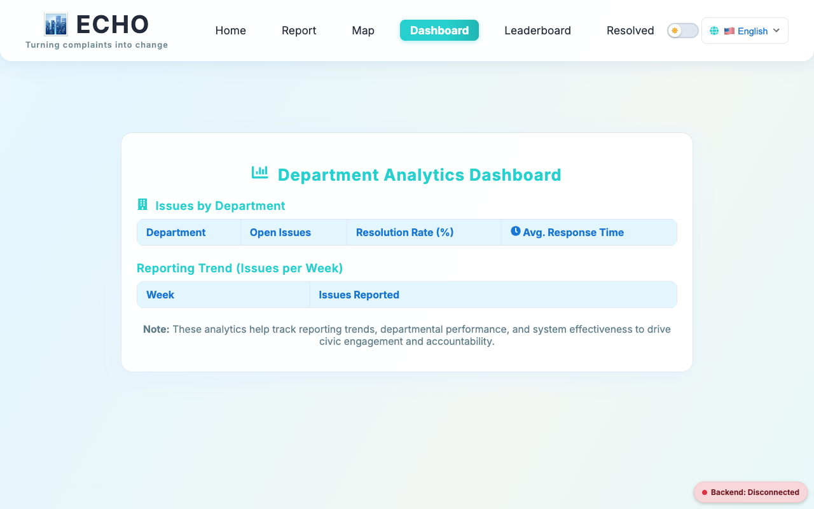
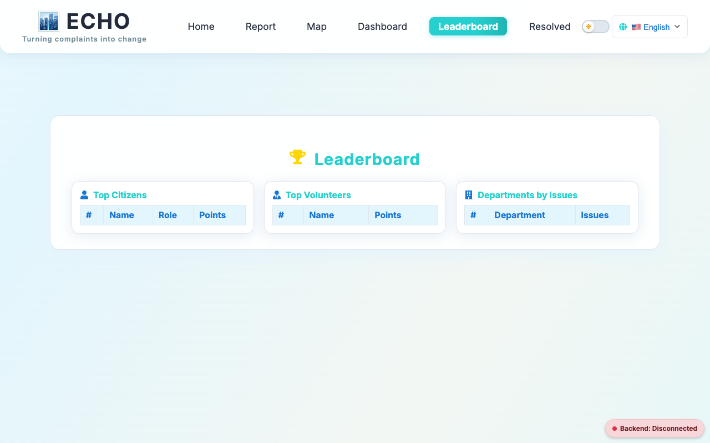
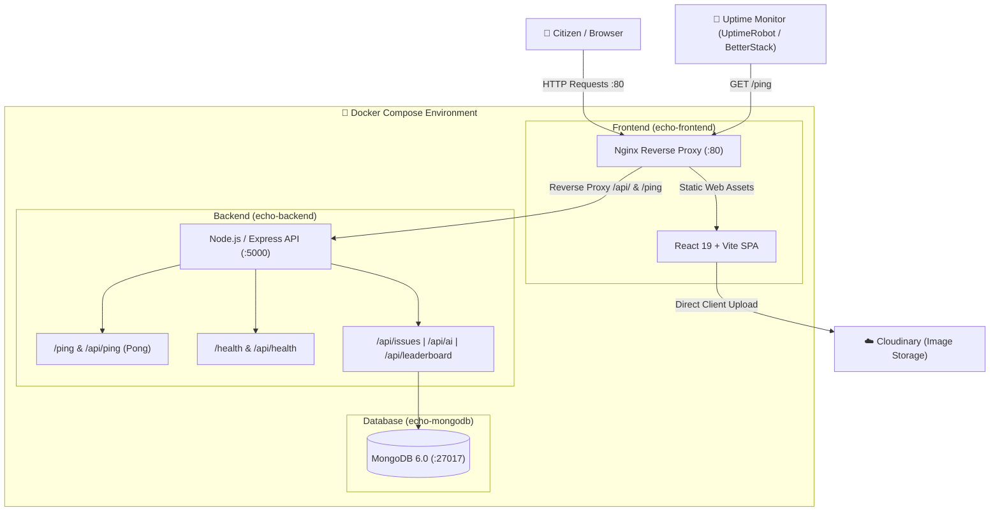

# 🏙️ ECHO — Civic Issue Reporting & Engagement Platform

> *"Turning complaints into change"* — An open-source, full-stack civic engagement platform that empowers citizens to report public infrastructure issues, tracks resolutions in real time, and gamifies civic action with community leaderboards and analytics.

---

[](https://www.docker.com/)
[](https://react.dev/)
[](https://vitejs.dev/)
[](https://nodejs.org/)
[](https://expressjs.com/)
[](https://www.mongodb.com/)
[](https://nginx.org/)
[](#-uptime-monitoring--ping-pong-api)

---

## 📸 Screenshots & Interface

### 1. Home Feed & Real-time Issue Stream
Browse reported community problems, filter by status or category, and upvote high-priority issues:


---

### 2. Issue Reporting with Cloudinary Media & Location
Submit civic reports with photo evidence, automatic AI urgency categorization, and exact locations:


---

### 3. Interactive Civic Map (Leaflet)
Geographic visualization of reported civic hazards with interactive pins and status badges:


---

### 4. Department Analytics & Resolution Dashboard
City-wide performance metrics, weekly reporting trends, and resolution statistics:


---

### 5. Community Leaderboard & Volunteer Gamification
Recognize top active citizens and volunteers with points and civic contribution ranks:


---

## ✨ Features

- 📍 **Geo-Tagged Civic Reporting:** Log road hazards, potholes, sewage overflows, garbage piles, and street lighting failures with descriptions, addresses, and images.
- 🤖 **AI-Assisted Classification:** Smart category classification and urgency rating (Low / Medium / High) for prompt municipal prioritization.
- 🗺️ **Interactive OpenStreetMap / Leaflet Map:** Pan and zoom through city clusters to view verified vs. pending issues.
- 🏆 **Gamification & Points System:** Earn civic karma points for reporting and verifying issues to encourage active community stewardship.
- 🌐 **Multi-Language Accessibility:** Instant switching between English, Hindi (हिंदी), Marathi (मराठी), and Gujarati (ગુજરાતી).
- 🌓 **Dark / Light Theme Toggle:** Accessible and responsive UI for day and night viewing.
- 📊 **Real-Time Connectivity Badge:** Live in-app pulse indicator showing backend connectivity status.
- ⏱️ **Uptime Monitor Endpoints:** Dedicated ping-pong and health check endpoints engineered for zero-downtime monitoring.
- 🐳 **Single-Command Docker Deployment:** Complete frontend, backend, and MongoDB containerization with reverse proxy and automated healthchecks.

---

## 🏛️ System Architecture



---

## 🚀 Quick Start with Docker (Deploy Everything All at Once)

Deploy the entire stack (React frontend, Express backend, and MongoDB database) with one command.

### 1. Prerequisites
- [Docker](https://docs.docker.com/get-docker/) (v20.10+)
- [Docker Compose](https://docs.docker.com/compose/) (v2.0+)

### 2. Clone and Configure
```bash
git clone https://github.com/atharva-sharma/Echo.git
cd Echo

# Copy the environment template
cp .env.example .env
```

*(Optional)* Customize variables in `.env` if you want to use MongoDB Atlas instead of the built-in MongoDB container, or configure your Cloudinary credentials.

### 3. Launch Stack
```bash
docker compose up --build -d
```

### 4. Access the Application
| Service | URL | Description |
| :--- | :--- | :--- |
| **Echo Web Application** | [http://localhost:80](http://localhost:80) | React SPA served via Nginx |
| **Ping-Pong Uptime Monitor** | [http://localhost:80/ping](http://localhost:80/ping) | Instant uptime check |
| **Backend API Direct** | [http://localhost:5001/api](http://localhost:5001/api) | Express API service |
| **Backend Health Check** | [http://localhost:5001/health](http://localhost:5001/health) | API + Database health |

### 5. Stop the Containers
```bash
# Stop containers
docker compose down

# Stop and wipe database volume (for fresh start)
docker compose down -v
```

---

## 📡 Uptime Monitoring & Ping Pong API

Echo provides dedicated, lightweight endpoints designed for external uptime monitors (e.g., **UptimeRobot**, **Better Stack**, **Cronitor**, **Pingdom**, **Healthchecks.io**, or cloud load balancers).

### 1. Ping-Pong Endpoint (`GET /ping` and `GET /api/ping`)
- Returns HTTP `200 OK` with JSON `{"message": "pong"}`
- Does not query the database, ensuring instantaneous response times (< 5ms) and preventing false alarms during database maintenance.

**Sample Request:**
```bash
curl -i http://localhost:80/ping
```

**Sample Response:**
```json
HTTP/1.1 200 OK
Content-Type: application/json; charset=utf-8

{
  "message": "pong",
  "status": "ok",
  "uptime": 3600,
  "timestamp": "2026-10-24T16:48:06.711Z"
}
```

### 2. Detailed Health Check Endpoint (`GET /health` and `GET /api/health`)
- Inspects database connectivity state (`connected`, `connecting`, `disconnected`).
- Returns system uptime in seconds and server timestamp.

**Sample Request:**
```bash
curl -i http://localhost:80/health
```

**Sample Response:**
```json
HTTP/1.1 200 OK
Content-Type: application/json; charset=utf-8

{
  "status": "OK",
  "message": "Echo API is running",
  "database": "connected",
  "uptime": 3600,
  "timestamp": "2026-10-24T16:48:06.732Z"
}
```

### 3. Setting Up on UptimeRobot / Better Stack
1. Create a new **HTTP(s) Monitor**.
2. Set the Monitor URL to:
   - `https://your-domain.com/ping` (or `http://your-server-ip/ping`)
3. Set the Monitoring Interval to **30 seconds** or **1 minute**.
4. Set Keyword Monitoring (optional): check that response contains `"message":"pong"`.

---

## 🔐 Environment Variables

Echo provides environment configuration templates across all layers.

### Root `.env` (Docker Compose Configuration)
| Variable | Default | Description |
| :--- | :--- | :--- |
| `FRONTEND_PORT` | `80` | Host port mapped to Nginx web frontend |
| `BACKEND_PORT` | `5001` | Host port mapped to Express backend *(avoiding macOS AirPlay 5000)* |
| `MONGO_PORT` | `27017` | Host port mapped to MongoDB |
| `PORT` | `5000` | Internal port the Express server listens on |
| `MONGODB_URI` | `mongodb://mongodb:27017/echo` | MongoDB connection string (local container or Atlas URI) |
| `VITE_API_URL` | `/api` | Base API route (proxied automatically by Nginx) |
| `VITE_CLOUDINARY_CLOUD_NAME` | *(your cloud name)* | Cloudinary cloud name for issue attachments |
| `VITE_CLOUDINARY_UPLOAD_PRESET` | `civic-issues` | Cloudinary unsigned upload preset |

### Backend `.env` (`backend/.env`)
| Variable | Default | Description |
| :--- | :--- | :--- |
| `PORT` | `5000` | Port for Express server |
| `MONGODB_URI` | `mongodb://localhost:27017/echo` | Connection URI for MongoDB |

### Frontend `.env` (`frontend/.env`)
| Variable | Default | Description |
| :--- | :--- | :--- |
| `VITE_API_URL` | `/api` | Base URL for API requests (`/api` for Docker, `http://localhost:5001/api` for local dev) |
| `VITE_CLOUDINARY_CLOUD_NAME` | — | Cloudinary cloud name |
| `VITE_CLOUDINARY_UPLOAD_PRESET` | — | Cloudinary unsigned preset name |

> [!NOTE]
> All template files are provided in the repository:
> - Root: [`.env.example`](file:///.env.example)
> - Backend: [`backend/.env.example`](file:///backend/.env.example)
> - Frontend: [`frontend/.env.example`](file:///frontend/.env.example)

---

## 💻 Local Development (Without Docker)

If you prefer to run services individually for active development:

### 1. Start MongoDB
Ensure a MongoDB instance is running locally on port `27017` or use an active MongoDB Atlas cluster URI.

### 2. Start the Backend
```bash
cd backend
cp .env.example .env

# Install dependencies
npm install

# (Optional) Seed demo users and leaderboard points
npm run seed

# Run server (defaults to port 5001 or 5000)
PORT=5001 npm run dev
```

### 3. Start the Frontend
```bash
cd frontend
cp .env.example .env

# Update frontend/.env to point to your local backend:
# VITE_API_URL=http://localhost:5001/api

npm install
npm run dev
```

Open [http://localhost:5173](http://localhost:5173) in your browser.

> [!TIP]
> **macOS AirPlay Conflict Notice:** On macOS Monterey, Ventura, Sonoma, and Sequoia, macOS AirPlay Receiver uses port `5000` by default. We default host mappings to port `5001` for the backend to prevent `EADDRINUSE` collisions.

---

## 🛠️ API Reference

| Method | Endpoint | Description |
| :--- | :--- | :--- |
| `GET` | `/ping` or `/api/ping` | Uptime monitor ping-pong (`{"message": "pong"}`) |
| `GET` | `/health` or `/api/health` | Comprehensive API & database connectivity check |
| `GET` | `/api/issues` | List issues with optional `?status=` and `?category=` query filters |
| `POST` | `/api/issues` | Submit a new civic issue report |
| `GET` | `/api/issues/:id` | Retrieve an issue and its community comments |
| `PUT` | `/api/issues/:id/upvote` | Upvote an issue to increase municipal urgency |
| `POST` | `/api/issues/:id/comments` | Add a public comment to an issue |
| `PUT` | `/api/issues/:id/resolve` | Mark an issue as resolved |
| `POST` | `/api/ai/gemini` | AI issue classification & urgency determination |
| `GET` | `/api/leaderboard` | Retrieve top citizens and volunteers sorted by points |

---

## 📂 Project Directory Structure

```plaintext
Echo/
├── .dockerignore                 # Root Docker ignore rules
├── .env                          # Root Docker environment variables
├── .env.example                  # Root environment template
├── .gitignore                    # Git exclusions
├── docker-compose.yml            # Multi-container orchestration (Frontend, Backend, Mongo)
├── README.md                     # Documentation & project guide
├── docs/
│   └── screenshots/              # High-resolution screenshots of Echo UI
│       ├── home.png
│       ├── report.png
│       ├── map.png
│       ├── dashboard.png
│       └── leaderboard.png
├── backend/
│   ├── .dockerignore             # Backend Docker ignore rules
│   ├── .env                      # Backend local environment
│   ├── .env.example              # Backend environment template
│   ├── Dockerfile                # Production Node.js Alpine image + healthcheck
│   ├── package.json              # Express, Mongoose, CORS, Bcrypt
│   ├── server.js                 # Express server & API endpoints
│   ├── seed.js                   # Mock user and leaderboard database seeder
│   ├── models/                   # Mongoose schemas (Issue, User, Comment)
│   └── routes/                   # Route handlers (issues, ai, leaderboard)
└── frontend/
    ├── .dockerignore             # Frontend Docker ignore rules
    ├── .env                      # Frontend local environment
    ├── .env.example              # Frontend environment template
    ├── Dockerfile                # Multi-stage Node build -> Nginx Alpine
    ├── nginx.conf                # Nginx reverse proxy configuration
    ├── package.json              # React 19, Vite, Leaflet, Framer Motion
    ├── vite.config.js            # Vite build configuration
    └── src/
        ├── App.jsx               # Navigation, routes, theme & language wrappers
        ├── api.js                # Axios instance with auth interceptor
        ├── components/           # Navbar, BackendStatus, SplashScreen, ThemeToggle, LanguageSwitcher
        ├── contexts/             # ThemeContext, LanguageContext (EN, HI, MR, GU)
        └── pages/                # Home, Report, IssueDetail, Map, Dashboard, Leaderboard, Resolved
```

---

## 🤝 Contributing

Contributions are welcome! Please follow these steps:
1. Fork the repository.
2. Create your feature branch (`git checkout -b feature/civic-improvement`).
3. Commit your changes (`git commit -m 'feat: add department escalation'`).
4. Push to the branch (`git push origin feature/civic-improvement`).
5. Open a Pull Request.

---

## 📄 License

This project is licensed under the [MIT License](LICENSE).
